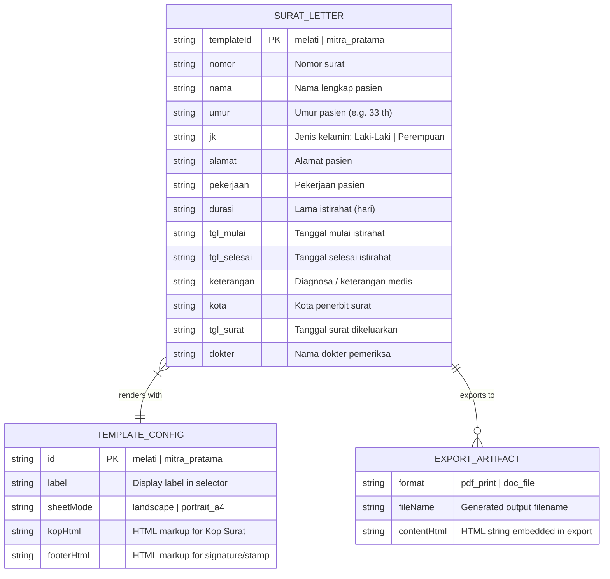

# Phase 2: Architecture & Data Modeling — surket

## 1. Application Structural Map

```
D:\Project\surket\
├── assets\
│   ├── logo.png                # Melati Medika clinic logo
│   ├── stempel.png             # Melati Medika stamp
│   ├── qr_dokter.png           # Melati Medika doctor QR code
│   ├── logo_mp.png             # Mitra Pratama cropped clinic emblem
│   └── stempel_sig_mp.png      # Mitra Pratama cropped stamp & doctor signature
├── docs\
│   ├── BRIEF.md                # Project brief & active state
│   ├── CHANGELOG.md            # Versioning changelog
│   ├── phase_1_discovery.md    # Phase 1 PRD & discovery notes
│   └── phase_2_architecture.md # Phase 2 system design & data models
├── template\
│   ├── mp.jpg                  # Reference scan for Mitra Pratama format
│   └── crops\                  # Verification crops
├── index.html                  # Main SPA (sidebar form + dynamic preview sheet)
└── README.md                   # Project overview & usage instructions
```

---

## 2. Data Modeling & State Schema

The application is an offline-first client-side tool. Data models are expressed as structured state objects, with draft persistence in browser `localStorage`.

### Entity-Relationship Diagram



### TypeScript Data Interface Specification

```typescript
export type TemplateId = 'melati' | 'mitra_pratama';
export type Gender = 'Laki-Laki' | 'Perempuan';

export interface SuratFormData {
  templateId: TemplateId;
  nomor: string;
  nama: string;
  umur: string;
  jk: Gender;
  alamat: string;
  pekerjaan: string;
  durasi: string;
  tgl_mulai: string;
  tgl_selesai: string;
  keterangan: string;
  kota: string;
  tgl_surat: string;
  dokter: string;
}

export interface TemplateDefinition {
  id: TemplateId;
  title: string;
  sheetClass: 'sheet-melati' | 'sheet-mp';
  pageSize: 'landscape' | 'portrait';
  defaultValues: Partial<SuratFormData>;
  render: (data: SuratFormData) => string;
}
```

---

## 3. Client Action Routes & Event Handlers

Since `surket` runs in-browser without server dependencies, API endpoints operate as strongly typed client-side message contracts:

| Action Identifier | Trigger | Input Payload | Output / Side Effect |
| :--- | :--- | :--- | :--- |
| `action:switchTemplate` | `<select id="template_id">` change | `{ templateId: TemplateId }` | Toggles form field visibility (e.g. doctor name), switches sheet CSS classes (`#sheet.sheet-melati` vs `#sheet.sheet-mp`), re-renders sheet. |
| `action:render` | Form `input` event | `SuratFormData` | Sanitizes input with `esc()`, evaluates template renderer, updates `#sheet.innerHTML`. |
| `action:print` | Click `#print` button | None | Triggers `window.print()` with active `@page` dimensions (`landscape` for Melati, `A4 portrait` for Mitra Pratama). |
| `action:dlDoc` | Click `#doc` button | `SuratFormData` | Generates MS Word compliant `.doc` Blob (`application/msword`) with UTF-8 BOM `\ufeff`, initiates download. |
| `action:saveDraft` | Input debounce (500ms) | `SuratFormData` | Serializes state to `localStorage.getItem('surket_draft')`. |
| `action:loadDraft` | Page `DOMContentLoaded` | None | Restores last saved state into form fields or falls back to defaults. |

---

## 4. Template Comparison & Layout Specs

| Attribute | Template 1: Melati Medika | Template 2: Mitra Pratama |
| :--- | :--- | :--- |
| **Source** | Original `index.html` | `template/mp.jpg` scan |
| **Paper Orientation** | Landscape (`277mm x 180mm`) | Portrait A4 (`210mm x 297mm`) |
| **Kop Logo** | Left side (`assets/logo.png`) | Left side (`assets/logo_mp.png`) |
| **Kop Border** | Single black rule (`2px`) | Double rule (thick over thin) |
| **Kop Text** | Klinik Melati Medika + Depok address | Klinik Pratama Rawat Inap Mitra Pratama + Izin Operasional + Bogor address |
| **Title** | `Surat Keterangan Sakit` | `SURAT KETERANGAN SAKIT` (centered, underlined) |
| **Sign-off Block** | Right-aligned QR code + Stamp | Right-aligned stamp & signature (`assets/stempel_sig_mp.png`) + `( dr. [nama] )` |
| **Print Styling** | `@page { size: 277mm 180mm landscape; margin: 0 }` | `@page { size: A4 portrait; margin: 12mm }` |
